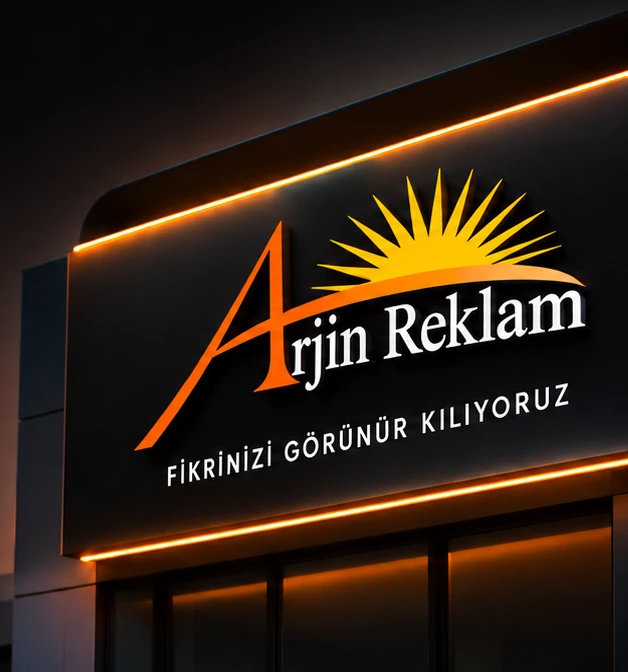

# Arjin Reklam — Corporate Website

A responsive, multi-page corporate website developed for **Arjin Reklam**, an Istanbul-based signage, digital printing and advertising company with 25 years of experience.

**Live website:** [arjinreklam.com](https://arjinreklam.com/)  
**Project gallery:** [View completed projects](https://arjinreklam.com/projeler.html)  
**Quote form:** [Request a quote](https://arjinreklam.com/teklif-al.html)



## Overview

The project helps visitors explore the company's services, browse photos of completed work, and prepare a detailed quotation request. It is a **static front-end website** built with HTML, CSS and vanilla JavaScript, deployed on Netlify.

## Features

- **Responsive design** for desktop and mobile devices.
- **338 project photographs** displayed in a category-filterable gallery, with enlarged-image viewing and navigation.
- **Dedicated service pages** for illuminated and non-illuminated signs, channel letters, digital printing, vehicle wrapping, totem signs, and window graphics.
- **Four-step quotation form** with service-specific fields such as dimensions, materials, quantity, lighting and installation.
- **WhatsApp quotation workflow:** the form generates a prefilled message; the visitor reviews it and explicitly sends it through WhatsApp. No prices are calculated or displayed on the site.
- **Contact page** with phone, email, WhatsApp, Instagram and TikTok links.
- **SEO foundations:** descriptive page titles, meta descriptions, canonical URLs, structured data, `robots.txt` and `sitemap.xml`.

## Tech Stack

| Technology | Purpose |
| --- | --- |
| HTML5 | Page structure and content |
| CSS3 | Layout, visual design and responsive styling |
| JavaScript (vanilla) | Navigation, project gallery and quotation form |
| Netlify | Static website hosting and deployment |
| Google Search Console | Sitemap submission and search performance monitoring |

## Run Locally

1. Clone the repository:
   ```bash
   git clone https://github.com/Yaser05071273669/arjin-reklam-website.git
   ```
2. Open the project folder in Visual Studio Code.
3. Run `index.html` with the **Live Server** extension, or serve the folder using any local static web server.

There is no build step or package installation required.

## Main Pages

- `index.html` — Homepage
- `hakkimizda.html` — About
- `hizmetler.html` — Services overview
- `projeler.html` — Completed projects gallery
- `teklif-al.html` — Dynamic quotation request
- `iletisim.html` — Contact
- Service-specific HTML pages, such as `isikli-tabela.html`, `kutu-harf-tabela.html` and `dijital-baski.html`

## How the Quote Form Works

1. The visitor selects a service.
2. The form asks for relevant measurements and production details.
3. The visitor provides project and contact information.
4. A formatted quotation request opens in WhatsApp for the visitor to send.

**Note:** The site does not receive or store form submissions on a server, and it does not send WhatsApp messages automatically. The company determines pricing after reviewing the request.

## Project Links

- **Website:** https://arjinreklam.com/
- **GitHub:** https://github.com/Yaser05071273669/arjin-reklam-website

## Credits and Content Rights

Website development and implementation: [Yaser05071273669](https://github.com/Yaser05071273669).

Arjin Reklam branding, logos and customer/project photography are business or third-party assets. **Their inclusion in this repository does not grant permission for reuse.** Please obtain the appropriate authorization before copying or republishing these materials.

No open-source license is granted for the project by this README.
